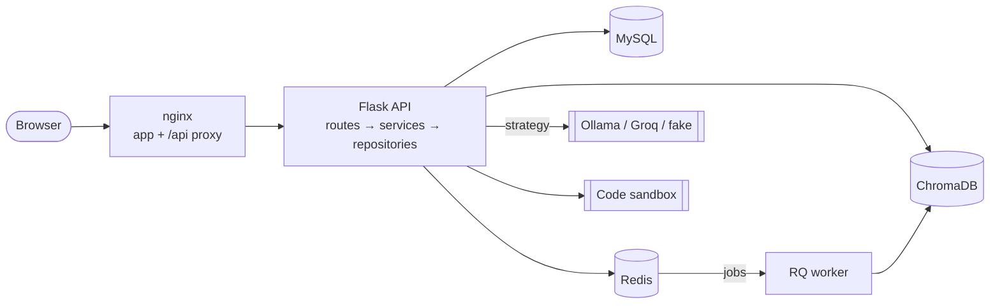

# Mistrally

[](https://github.com/radhikakumar0705/mistrally/actions/workflows/ci.yml)

A private AI teaching assistant for programmers. Mistrally streams answers from local LLMs (Mistral, Llama
and others via **Ollama**) or hosted ones (**Groq**), answers questions about your own notes with
**retrieval-augmented generation**, generates quizzes and flashcards, runs Python in a sandbox, and deploys
anywhere from a laptop to **Kubernetes**.

**Stack:** React 18 · TypeScript · Vite · Tailwind CSS · Flask · SQLAlchemy/Alembic · MySQL · ChromaDB ·
Redis/RQ · Ollama · Docker · Kubernetes (Kustomize) · Prometheus/Grafana/OpenTelemetry · GitHub Actions

**Docs:** [Design document](docs/design.md) · [Retrieval evaluation](docs/rag-evaluation.md) ·
[OpenAPI spec](backend/openapi.yaml) (interactive at `/api/docs` when running)

---

## Features

- **Streaming chat**: answers appear token by token over server-sent events, with **Stop**, **Regenerate**
  and **Export to Markdown**
- **Chat with your notes**: upload PDF, TXT or Markdown files. They're processed in the background (with a
  progress bar), searched with hybrid BM25 + embedding retrieval and a re-ranker, and cited by document
  and page under each answer
- **Study mode**: quizzes and flashcards generated from a document or topic, with schema-validated model output
- **Run code**: a Run button on Python code blocks executes them in an isolated sandbox
- **Accounts**: password or **Google sign-in**; short-lived access tokens, rotating refresh tokens, CSRF
  protection, rate limiting
- **Model choice**: any installed Ollama model per conversation, or a hosted model via Groq
- **Dark, responsive UI**: conversations grouped by date with search, rename and delete; deep links
  (`/chat/42`); mobile drawer

## Architecture



The backend is layered (HTTP routes → services with business rules → repositories, the only code touching
the database) and uses named patterns:
- **Strategy:** model providers.
- **Repository:** data access.
- **Dependency injection:** services take their collaborators, so they can be unit-tested with fakes.
- **Producer-consumer queue:** documents are indexed by a separate worker.

The full write-up, with flows, data model, security and trade-offs, is in [docs/design.md](docs/design.md).

| Area | Highlights |
|---|---|
| Retrieval | Structure-aware chunking, BM25 + embeddings with Reciprocal Rank Fusion, cross-encoder re-ranking; **hit@1 71% → 100%** on the evaluation set, gated in CI |
| Contract | OpenAPI 3.1 spec; contract tests validate every response and streamed event; frontend types generated from the spec with drift detection |
| Security | Refresh-token rotation with reuse detection, CSRF double-submit, no auto-linking of Google accounts, sandbox with no network route |
| Observability | Prometheus metrics (time to first token, generation speed, answer outcomes), Grafana dashboard, JSON logs with request IDs, OpenTelemetry traces |
| Testing | 115 backend tests (unit, integration, contract, migrations), 22 frontend tests, retrieval quality gate, sandbox limit checks, a feature built test-first |

---

## Run it

All options need a model: [Ollama](https://ollama.com) with `ollama pull mistral`, or set
`LLM_PROVIDER=groq` with a free `GROQ_API_KEY`, or `LLM_PROVIDER=fake` to try it without any model.

### Docker Compose (recommended)

```bash
cp .env.example .env        # fill in the secrets
docker compose up --build
```

Open <http://localhost:8090>. Add `--profile monitoring` for Prometheus (:9090), Grafana (:3001) and Jaeger
(:16686), or `--profile ollama` to run Ollama in a container.

### Kubernetes

```bash
docker compose build
cp k8s/overlays/local/secrets.env.example k8s/overlays/local/secrets.env   # fill in
kubectl apply -k k8s/overlays/local
kubectl -n mistrally port-forward svc/frontend 8090:80
```

### Local development

```bash
cd backend && python -m venv venv && venv\Scripts\activate && pip install -r requirements-dev.txt
cp .env.example .env && python app.py          # migrates, then serves :5000
cd frontend && npm install && npm run dev       # http://localhost:5173
```

Optional: set `TASK_QUEUE_URL=redis://localhost:6379/1` and run `python worker.py` to process uploads in the
background (otherwise they're processed inline).

## Tests

```bash
cd backend  && pytest && ruff check . && python -m eval.run_retrieval --check
cd frontend && npm test && npm run lint && npm run typecheck
```

## Project structure

```
backend/
  routes/         HTTP layer (auth, chat, documents, study)
  services/       use cases: chat, auth, documents, study, retrieval, ingestion, export
    llm/          model providers (Strategy)
  repositories/   database access (Repository)
  models/  migrations/  tests/  eval/
  openapi.yaml    API contract
frontend/src/
  pages/  components/  hooks/  api/ (typed client + generated schema)  lib/
sandbox/          isolated Python runner
monitoring/       Prometheus, alert rules, Grafana dashboard
k8s/              Kustomize base, overlays, optional Ollama component
docs/             design.md, rag-evaluation.md
```
