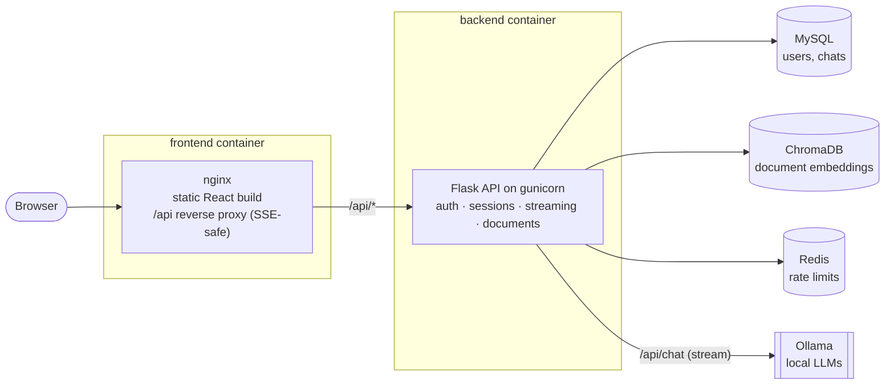

# Mistrally

[](https://github.com/radhikakumar0705/mistrally/actions/workflows/ci.yml)

A private AI teaching assistant for programmers. Mistrally streams answers from local LLMs (Mistral, Llama
and others via **Ollama**), answers questions about your own documents with **retrieval-augmented
generation**, and runs anywhere from a laptop to a **Kubernetes** cluster.

**Stack:** React 18 · Vite · Tailwind CSS · Flask · SQLAlchemy/Alembic · MySQL · ChromaDB · Redis · Ollama ·
Docker · Kubernetes (Kustomize) · GitHub Actions

---

## Features

- **Streaming chat**: answers appear token by token over server-sent events, with **Stop** and **Regenerate**
- **Chat with your documents (RAG)**: upload PDF/TXT files; relevant passages are retrieved from ChromaDB,
  passed to the model, and shown as **source chips** under the answer. Each user only searches their own documents
- **Conversations**: create, rename, search, delete; grouped by date and ordered by last activity; deep links
  (`/chat/42`)
- **Model picker**: choose any installed Ollama model per conversation
- **Markdown answers** with syntax-highlighted code blocks and one-click copy
- **Modern dark UI**: responsive layout with a mobile drawer, keyboard shortcuts, toasts, skeleton loading
- **Accounts**: JWT authentication, bcrypt password hashing, input validation, Redis-backed rate limiting

## Architecture



**How a message flows:** the browser POSTs to `/api/chat/sessions/:id/messages` → Flask embeds the question,
retrieves the user's most relevant document chunks from Chroma (filtered by `user_id`, with a similarity
cutoff) → builds a prompt from the system prompt, retrieved excerpts and the last 5 turns → streams Ollama's
`/api/chat` response back as server-sent events → saves the answer and its sources to MySQL when it finishes
(or keeps the partial answer if the user pressed Stop).

### Engineering highlights

| Area | What and why |
|---|---|
| Streaming | `fetch` + `ReadableStream` SSE client (POST with auth headers, abortable), Flask `stream_with_context`, `proxy_buffering off` in nginx and the Ingress |
| RAG | Chunking with overlap, per-user metadata filters, distance threshold so unrelated questions get no context, citations stored with each answer |
| Embeddings | `all-MiniLM-L6-v2` on ONNX Runtime (via Chroma) instead of PyTorch: the backend image is ~0.9 GB instead of 3 GB+ |
| Database | Alembic migrations (Flask-Migrate) that adopt older databases in place and move legacy messages into a session |
| Security | Required secrets (no fallbacks), JWT expiry handling, bcrypt, per-user data isolation, rate limiting keyed by user/IP behind `ProxyFix`, non-root containers with read-only root filesystems |
| Frontend | Vite, code-split chat route, a `useChat` hook that owns sessions, streaming state and cancellation |
| Ops | Multi-stage Docker builds, health/readiness endpoints, Compose with a one-shot migration job, Kustomize base + overlay, HPA, PodDisruptionBudgets, NetworkPolicies |
| Quality | 29 backend tests (pytest) incl. migrations and stream cancellation, 14 frontend tests (Vitest + Testing Library), Ruff, ESLint, CI on every push |

---

## Run it

All three options need [Ollama](https://ollama.com) with a model pulled: `ollama pull mistral`.

### Option 1: Docker Compose (recommended)

```bash
cp .env.example .env        # fill in the four secrets
docker compose up --build
```

Open <http://localhost:8090>. Compose starts MySQL, ChromaDB, Redis, runs the database migrations, then
starts the API and the web app. It uses the Ollama on your machine; to run Ollama in a container instead,
set `OLLAMA_URL=http://ollama:11434` in `.env` and run `docker compose --profile ollama up --build`.

### Option 2: Kubernetes

Works with Docker Desktop's built-in Kubernetes or [kind](https://kind.sigs.k8s.io/).

```bash
docker compose build                                   # builds mistrally-backend:local and mistrally-frontend:local
# kind only: kind load docker-image mistrally-backend:local mistrally-frontend:local
cp k8s/overlays/local/secrets.env.example k8s/overlays/local/secrets.env   # fill in
kubectl apply -k k8s/overlays/local
kubectl -n mistrally get pods -w
kubectl -n mistrally port-forward svc/frontend 8090:80   # or use the Ingress at http://mistrally.localhost
```

What gets deployed (`k8s/base`): MySQL StatefulSet with a persistent volume, ChromaDB and Redis, a migration
Job, the API (2+ replicas, HPA on CPU, startup/readiness/liveness probes, PodDisruptionBudget), the web app,
an Ingress, and NetworkPolicies that only let the API reach the data stores. To run Ollama in the cluster,
enable the `components/ollama` component in the overlay.

### Option 3: Local development

**Backend** (needs MySQL running):

```bash
cd backend
python -m venv venv
venv\Scripts\activate         # macOS/Linux: source venv/bin/activate
pip install -r requirements-dev.txt
cp .env.example .env          # fill in SECRET_KEY, JWT_SECRET_KEY and the DB_* values
python app.py                 # applies migrations, then serves http://127.0.0.1:5000
```

**Frontend:**

```bash
cd frontend
npm install
npm run dev                   # http://localhost:5173, proxies /api to the backend
```

**Upgrading an existing database:** migrations run automatically with `python app.py` (or run
`flask --app wsgi db upgrade`). Databases from earlier versions are adopted in place, and old messages are
kept in an "Earlier chats" conversation.

---

## Tests and linting

```bash
cd backend  && pytest && ruff check .
cd frontend && npm test && npm run lint
```

CI (`.github/workflows/ci.yml`) runs both suites, validates the Compose file and the rendered Kubernetes
manifests (kubeconform), and builds both images, pushing them to GitHub Container Registry on pushes.

---

## API

All `/chat` and `/documents` routes need an `Authorization: Bearer <token>` header from `/auth/login`.

| Method | Route | Purpose |
|---|---|---|
| POST | `/auth/register` | Create an account (`username`, `email`, `password` of 8+ characters) |
| POST | `/auth/login` | Returns `access_token` and the user |
| GET | `/auth/profile` | Current user |
| GET | `/chat/models` | Installed Ollama models and the default |
| GET / POST | `/chat/sessions` | List or create conversations (`title`, `model` optional) |
| PATCH / DELETE | `/chat/sessions/<id>` | Rename or change model / delete a conversation |
| GET | `/chat/sessions/<id>/messages` | Conversation history with sources |
| POST | `/chat/sessions/<id>/messages` | Send `{"message": "..."}`; **streams** `start`, `token`, `done` / `error` events |
| POST | `/chat/sessions/<id>/regenerate` | Stream a new answer to the last message, replacing the old one |
| GET / POST | `/documents` | List or upload (`file` form field, PDF/TXT) documents |
| DELETE | `/documents/<id>` | Remove a document from the knowledge base |
| GET | `/health/live`, `/health/ready` | Liveness and readiness (database) checks |

## Project structure

```
backend/
  app.py, wsgi.py, config.py, extensions.py, gunicorn.conf.py, Dockerfile
  routes/        auth, chat (sessions + streaming), documents
  services/      ollama_service (streaming client), chroma_service (RAG)
  models/        User, ChatSession, ChatHistory
  migrations/    Alembic revisions
  tests/         pytest suite
frontend/
  src/pages/     Home (landing), Login, Signup, Chat, NotFound
  src/components/chat/   Sidebar, MessageList, Message, Markdown, Composer, ModelPicker, EmptyState
  src/hooks/     useChat (sessions + streaming), useDocuments
  src/api/       axios client, SSE streaming client
  nginx/         production nginx config (SPA + /api proxy)
k8s/
  base/          namespace, config, MySQL, Chroma, Redis, migrate Job, backend, frontend, Ingress, NetworkPolicies
  components/ollama/   optional in-cluster Ollama
  overlays/local/      secrets + local image tags
docker-compose.yml
.github/workflows/ci.yml
```
