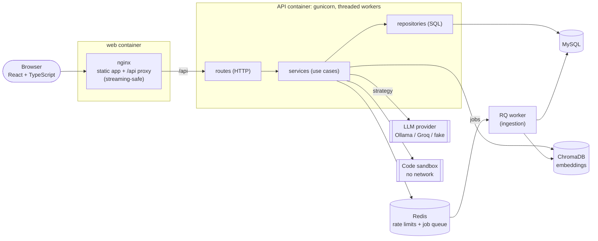
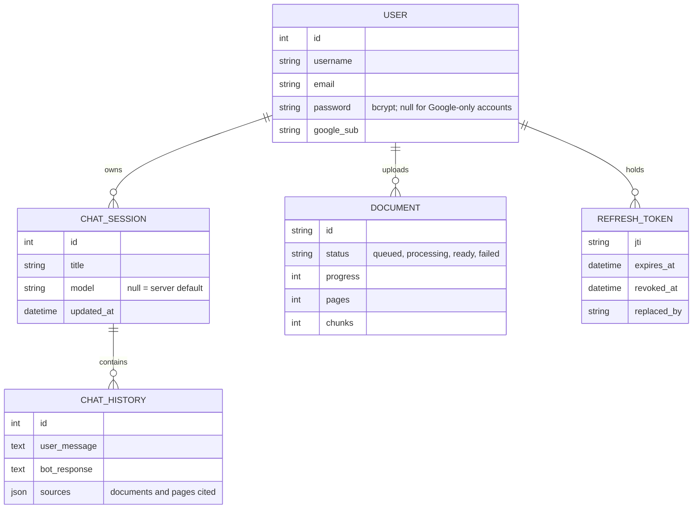
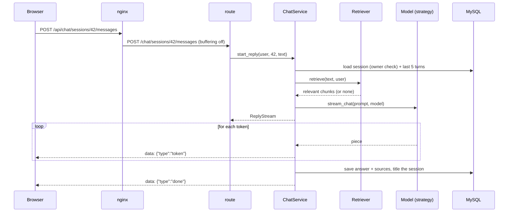

# sockRat design

sockRat is a private AI teaching assistant for programmers: chat with a local or hosted language model,
ask questions about your own notes (retrieval-augmented generation), and practise with generated quizzes,
flashcards and runnable code. This document explains how it is built and why.

- API contract: [`backend/openapi.yaml`](../backend/openapi.yaml) (browsable at `/api/docs`)
- Retrieval measurements: [`docs/rag-evaluation.md`](rag-evaluation.md)

## 1. Goals and constraints

| Goal | Consequence for the design |
|---|---|
| Answers feel instant | Token streaming end to end (model → Flask → nginx → browser), never buffered |
| Private by default | Runs fully on local models via Ollama; hosted models are an opt-in strategy |
| Answers grounded in the user's notes | Per-user document store, hybrid retrieval, citations with page numbers |
| Uploads never block chatting | Document processing runs in a separate worker behind a queue |
| Safe to expose | Short-lived tokens, rotating refresh tokens, CSRF protection, rate limits, an isolated code sandbox |
| Easy to change | Layered backend with injected dependencies, a typed API contract, tests at every layer |

## 2. Architecture



| Component | Responsibility |
|---|---|
| **web** (nginx) | Serves the built React app; proxies `/api/*` to Flask with buffering off so tokens stream; adds a request ID and security headers |
| **API** (Flask on gunicorn) | Authentication, conversations, streaming answers, retrieval, study tools |
| **worker** (RQ) | Extracts, chunks and embeds uploaded documents, reporting progress |
| **MySQL** | Users, refresh tokens, conversations, messages, document records (schema managed by Alembic migrations) |
| **ChromaDB** | Document chunks and their embeddings, filtered per user |
| **Redis** | Shared rate-limit counters (database 0) and the document job queue (database 1) |
| **sandbox** | Runs Python snippets with no network and strict resource limits |
| **LLM provider** | Ollama locally, Groq (or any OpenAI-compatible API) for the hosted demo, a fake model for tests |

## 3. Backend structure and patterns

```
backend/
  routes/        HTTP only: parse the request, call a service, serialize the result
  services/      use cases and business rules (ChatService, AuthService, DocumentService, StudyService)
    llm/         model providers (Strategy)
    errors.py    domain errors
  repositories/  the only code that queries the database
  models/        SQLAlchemy entities
  migrations/    Alembic revisions
```

**Layered architecture (routes → services → repositories).** Routes contain no business rules and no queries.
For example, `POST /chat/sessions/<id>/messages` is four lines: read the body, call
`ChatService.start_reply`, and wrap the resulting events as server-sent events. This keeps HTTP concerns
(cookies, status codes, streaming) separate from rules such as "a user can only read their own
conversations".

**Repository pattern.** `ChatSessionRepository`, `MessageRepository`, `DocumentRepository`, `UserRepository`
and `RefreshTokenRepository` (on a generic `SqlAlchemyRepository`) are the only classes that build queries.
Ownership checks live in one place (`owned(session_id, user_id)` returns `None` for other users' rows, which
surfaces as a 404, so no one can probe which ids exist). Repositories add, find and delete; services decide
when to commit.

**Strategy pattern (model providers).** `services/llm/base.py` defines the `Provider` interface
(`stream_chat`, `complete_json`, `list_models`). `OllamaProvider`, `OpenAICompatibleProvider` (Groq, OpenAI)
and `FakeProvider` are interchangeable strategies, and `get_provider()` selects one from `LLM_PROVIDER`.
Switching sockRat from local Mistral to a hosted Llama model is a configuration change. Each strategy
also supports schema-constrained JSON (Ollama enforces the schema during generation; OpenAI-compatible APIs
use JSON mode), which the quiz generator relies on.

**Dependency injection.** Services receive their collaborators through the constructor, for example
`ChatService(sessions, messages, models, retriever)` and `DocumentService(documents, vector_store, queue)`,
with production defaults. `tests/test_services_unit.py` passes in-memory fakes and tests the business rules
with no database, vector store or model. (Those tests found a real bug: the streaming code assumed every
provider returns a generator, while the interface only promised an iterator.)

**Domain errors.** Services raise `NotFound`, `InvalidInput`, `Conflict`, `Unprocessable`, `Unauthorized` or
`DependencyUnavailable`; one handler in `app.py` turns them into `{"error": ...}` JSON with the right status.

**Producer-consumer queue.** `DocumentService.upload` (producer) validates a file, records it as `queued`
and enqueues a job on Redis; the RQ worker (consumer, a separate process) extracts, chunks and embeds it,
updating `progress` after each batch of 32 chunks. Upload requests return `202 Accepted` immediately, and
chatting is never blocked by indexing. Without Redis (`TASK_QUEUE_URL` unset) the same function runs inline.
The worker uses RQ's `SimpleWorker`, which runs jobs in its own process without forking, so the embedding
and re-ranking models stay loaded between jobs.

**Concurrency in the API.** gunicorn runs threaded workers (`gthread`, 2 processes × 8 threads), so a long
streamed answer occupies one thread while others keep serving requests. Prometheus metrics use
multi-process mode so counters from all workers are merged.

## 4. Data model



Document chunks live in ChromaDB, each tagged with `user_id`, `doc_id`, `source`, `page` and `section`.
Every query filters on `user_id`.

## 5. Key flows

### Sending a message (streaming)



If the browser disconnects (the user pressed Stop), the generator is closed. `ReplyStream` closes the model
stream (Ollama stops generating) and still saves the partial answer.

### Uploading a document

`POST /documents` → `DocumentService.upload` records the file as `queued` and enqueues a job → `202`.
The worker sets `processing`, extracts text per PDF page, chunks it along headings and paragraphs, embeds
in batches while updating `progress`, then marks it `ready` (or `failed` with a reason, removing any partial
chunks). The UI polls `GET /documents` while anything is pending.

### Retrieval

1. Dense candidates: embedding similarity (`all-MiniLM-L6-v2` on ONNX Runtime) from Chroma.
2. Sparse candidates: BM25 keyword scores over the user's chunks (exact identifiers, error codes, names).
3. Reciprocal Rank Fusion merges the two rankings.
4. A cross-encoder (FlashRank MiniLM-L12) re-scores the top 12. Anything below a calibrated cutoff is
   dropped, so questions the notes can't answer get no context instead of misleading context.

Measured on a 53-question set: hit@1 rose from 71% (the original fixed-size chunks with embeddings only) to
100%, with 100% no-answer accuracy. Retrieval takes about 120 ms on a laptop CPU. The set is small and the
cutoff was tuned on it; see the caveats in [rag-evaluation.md](rag-evaluation.md).

Embeddings are computed by `services/embeddings.py`, which uses the same MiniLM model files as Chroma but
pads each batch only to its longest text and caps threads per inference. The vectors are identical and it
is 75x faster (see [performance.md](performance.md)). Retrieval is also skipped entirely for users who have
no documents.

### Authentication

- Password login or Google sign-in (OAuth 2.0 authorization code flow with PKCE, via Authlib).
- The access token is a JWT valid for 15 minutes, kept only in memory by the frontend and sent as a
  Bearer header.
- The refresh token is a JWT valid for 30 days, kept in an `httpOnly`, `SameSite=Strict` cookie scoped to
  `/api/auth/`. It is stored server-side, rotated on every use, and protected by a double-submit CSRF token.
- Reusing an already-rotated refresh token is treated as theft, and all of that user's sessions are revoked.
- A Google identity is never linked automatically to an existing password account with the same email,
  because sign-up emails are not verified. Linking happens from inside the signed-in account.

## 6. API contract

`backend/openapi.yaml` (OpenAPI 3.1) is the source of truth for the API:

- **Backend:** contract tests run a full user journey and validate every response, including each streamed
  event, against the spec. They also fail if a Flask route is missing from the spec or the spec lists a
  route that doesn't exist.
- **Frontend:** TypeScript types are generated from the spec (`npm run types:api`). CI regenerates them and
  fails if they differ from what's committed, so the client can't drift from the server.

## 7. Security

| Threat | Mitigation |
|---|---|
| Stolen access token | 15-minute lifetime; kept in memory, not `localStorage` |
| Stolen refresh token | httpOnly cookie; rotation with reuse detection revokes every session |
| CSRF on cookie-authenticated endpoints | Double-submit token header; `SameSite=Strict` |
| Account takeover through Google sign-in | No auto-linking by email; linking requires an existing session |
| Reading another user's data | Ownership enforced in repositories; vector queries filtered by `user_id`; 404 rather than 403 |
| Credential stuffing, abuse | Redis-backed rate limits keyed by user or IP behind `ProxyFix` |
| Untrusted code from "Run" | Separate container: no network route, non-root, read-only filesystem, no capabilities, CPU, memory, process and file-size limits, 5-second timeout, token-authenticated |
| Document contents leaking into logs | Job descriptions omit payloads; logs carry request IDs, not bodies |
| Container compromise | Non-root images, read-only root filesystems, dropped capabilities, NetworkPolicies limiting which pods can reach the databases |

## 8. Observability

- **Metrics:** Prometheus counters and histograms at `/metrics`, with an alert rules file and a provisioned
  Grafana dashboard. They cover HTTP request rate and latency, time to first token, generation speed, answer
  outcomes (completed, stopped, error, model unavailable), retrieval latency, chunks used per answer, and
  ingestion results.
- **Logs:** structured JSON. nginx generates a request ID that Flask reuses, so one ID links both log lines,
  alongside the OpenTelemetry trace ID.
- **Traces:** OpenTelemetry spans for Flask, outgoing model calls and SQL, exported to Jaeger when
  `OTEL_EXPORTER_OTLP_ENDPOINT` is set.

## 9. Testing strategy

| Level | What | Where |
|---|---|---|
| Unit | Services with fake repositories and models; chunking; prompt building; providers with fake HTTP | `tests/test_services_unit.py`, `test_chunking.py`, `test_llm_providers.py` |
| Integration | HTTP endpoints against SQLite and a real Chroma store | `tests/test_*.py` |
| Contract | Every response validated against `openapi.yaml` | `tests/test_openapi_contract.py` |
| Migrations | Upgrading empty, legacy and older schemas | `tests/test_migrations.py` |
| Quality gate | Retrieval hit rate and no-answer accuracy must not regress | `eval/run_retrieval.py --check` |
| End-to-end | Real browser against the Docker stack: sign-up, streaming, Stop, uploads, citations, export, quiz, code runner, logout | `frontend/e2e/` (Playwright) |
| Load | 20 concurrent users with and without documents, with latency thresholds | `loadtest/chat.js` (k6), [performance.md](performance.md) |
| Security limits | The sandbox actually blocks loops, memory and fork bombs, network access | `sandbox/smoke_test.py` |
| Frontend | Components, stream parsing, date grouping | Vitest + Testing Library |

**Test-driven development.** Conversation export was built test-first. Commit `df9fc9c` adds the
specification as failing tests (the module didn't exist), and the next commit implements it until they pass.

All of these run in GitHub Actions on every push, alongside linting (Ruff, ESLint), a strict TypeScript
check, API type drift detection, Kubernetes manifest validation, and image builds.

## 10. Deployment

- **Docker Compose:** the full stack with health checks and a one-shot migration job; optional
  `monitoring` and `ollama` profiles.
- **Kubernetes (Kustomize):** a MySQL StatefulSet, a migration Job, an API Deployment with HPA and
  PodDisruptionBudget, the worker, the sandbox with deny-all egress, an Ingress, and NetworkPolicies.
  Secrets come from a git-ignored env file.

## 11. Trade-offs and alternatives

| Decision | Alternative | Why |
|---|---|---|
| Flask + threaded gunicorn | FastAPI / asyncio | The existing code was Flask; streaming via threads is simple and adequate at this scale. Very high concurrency would favour async I/O. |
| RQ on Redis | Celery | One queue and one job type; RQ is far less configuration. Celery adds routing, retries and beat scheduling we don't need yet. |
| ChromaDB | pgvector, Qdrant | Simple to embed or run as a server; per-user filtering is enough. pgvector would drop a service if the database moved to Postgres. |
| ONNX embeddings, no PyTorch | sentence-transformers | Same model at about a third of the image size (~0.9 GB vs 3 GB+), and fast enough on CPU. |
| Hybrid search + re-ranker | Embeddings only | Measured gain in [rag-evaluation.md](rag-evaluation.md); costs about 110 ms per question. |
| Hand-written OpenAPI spec + contract tests | Generated from code (flask-smorest) | Spec-first keeps the contract readable and reviewable; tests stop it drifting from the code. |
| Refresh tokens in cookies | Long-lived tokens in `localStorage` | Shorter exposure window and revocation, at the cost of CSRF handling. |
| Container sandbox | gVisor / Firecracker microVMs | Adequate for a learning app; a public multi-tenant service should use a stronger isolation boundary. |

## 12. Future work

- A larger, held-out retrieval evaluation set, plus answer-quality evaluation (LLM-as-judge)
- Server-sent progress events for uploads instead of polling
- A per-user quota on stored documents
- Moving to Postgres with pgvector to consolidate MySQL and Chroma
